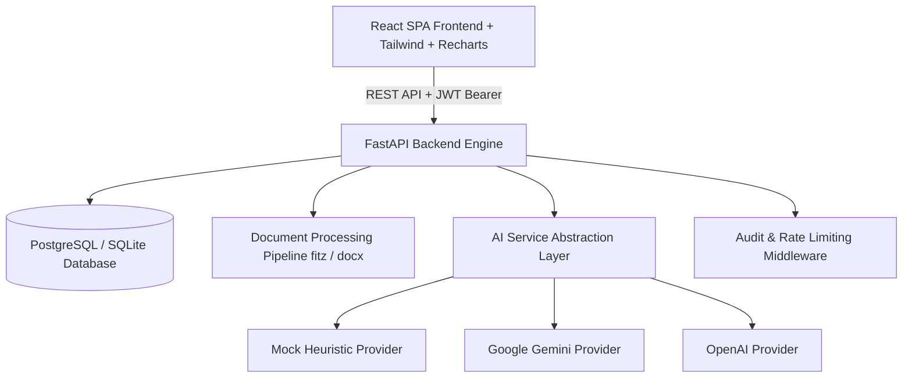

# CareerMatch AI — Architecture Documentation

## 1. System Overview

CareerMatch AI is designed around a modern, modular, production-ready full-stack architecture that enables candidates to understand their job fit transparently, discover skill gaps, improve resume quality, and manage their complete job application lifecycle.



## 2. Monorepo Structure

- **`frontend/`**: Vite + React 18 + TypeScript + Tailwind CSS + TanStack Query + React Router + Recharts + Lucide Icons.
- **`backend/`**: Python 3.13 + FastAPI + SQLAlchemy 2.0 + Pydantic v2 + PyMuPDF + python-docx + Pytest.
- **`docker-compose.yml`**: Production container orchestration (PostgreSQL, Redis, Backend, Frontend).

## 3. Explainable AI Matching Pipeline

Rather than relying on opaque black-box scoring, the matching engine applies structured component attribution combined with semantic vector cosine similarity:

1. **Structured Skill Matching (35% weight)**: Compares required and preferred job skills against candidate skills verified in their profile or parsed resume text. Categorizes each into `matched`, `partial`, or `no_evidence`.
2. **Experience Alignment (20% weight)**: Analyzes work history tenure and seniority progression against the job's prerequisite experience.
3. **Project Relevance (15% weight)**: Evaluates hands-on implementation evidence in the candidate's portfolio projects.
4. **Education Alignment (10% weight)**: Checks academic degrees against requirements.
5. **Certification Relevance (5% weight)**: Validates industry credentials (e.g. AWS, CISSP).
6. **Semantic Similarity (15% weight)**: Vector dot-product / cosine similarity between normalized candidate profile representations and job descriptions.

## 4. AI Provider Abstraction Layer

The application utilizes a polymorphic `BaseAIProvider` interface:

```python
class BaseAIProvider(ABC):
    def analyze_resume(self, text, profile_data): ...
    def analyze_job_description(self, jd_text): ...
    def match_resume_to_job(self, candidate_data, job_data): ...
    def generate_cover_letter(self, candidate_data, job_data, tone): ...
    def generate_application_email(self, candidate_data, job_data, email_type, contact_person): ...
    def generate_interview_prep(self, job_data, candidate_data, interview_type): ...
```

Three implementations exist:
- **`MockAIProvider`**: Default provider with zero external API dependencies. Implements comprehensive skill dictionaries, regex extraction, n-gram vector similarity, and rule-based heuristics. Guaranteed to run locally without internet or billing dependencies.
- **`GeminiAIProvider`**: Google Gemini generative API with graceful fallback.
- **`OpenAIProvider`**: OpenAI GPT generative API with graceful fallback.

## 5. Background Tasks & Scalability

- Uploaded files are validated on magic bytes, file extensions, and MIME headers.
- Parsing and text extraction run with asynchronous I/O and threadpool execution.
- Extensible to Celery and Redis workers via Docker Compose for distributed batch ingestion.
